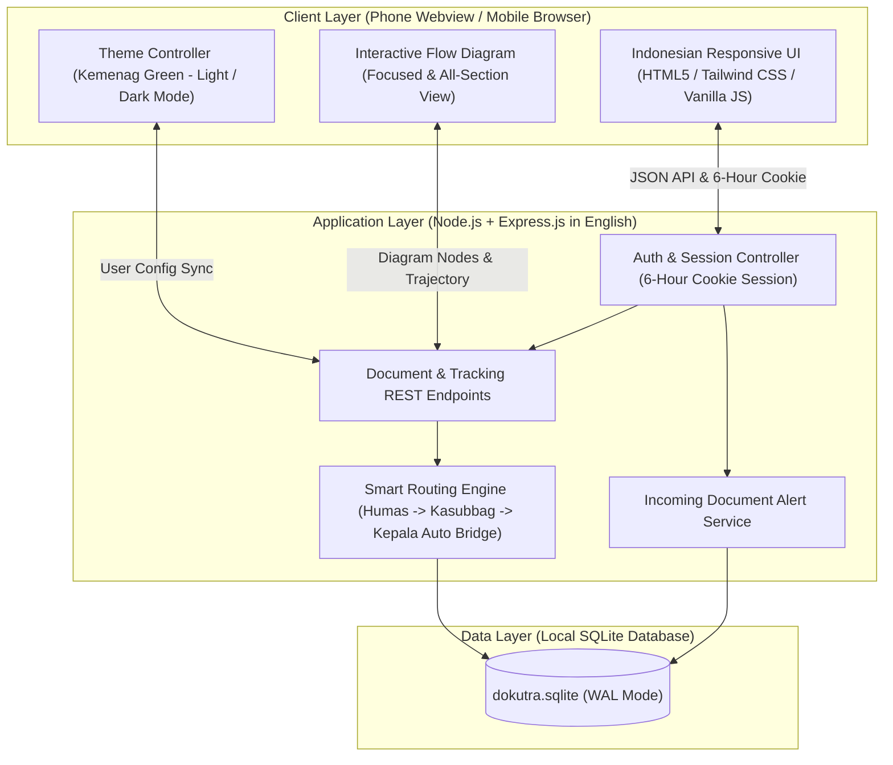
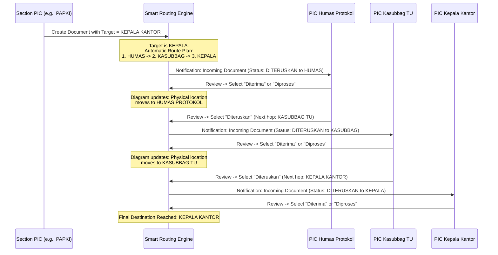

# System Architecture - DOKUTRA
**Kantor Kementerian Agama Kota Metro Document Tracking System**

---

## 1. Architectural Overview
DOKUTRA is designed as a **Lightweight Node.js + Local SQLite Web Application** with a **Mobile-First Responsive Webview Architecture**. This ensures fast loading on office local networks or low-tier hosting, complete local data persistence without needing standalone database server daemons, and optimal responsiveness when embedded in Android or iOS webviews.



---

## 2. Technology Stack & Design Decisions
- **Runtime:** Node.js (LTS).
- **Backend Framework:** Express.js (Clean modular English route handlers, controllers, and services).
- **Database:** SQLite3 (`better-sqlite3` or `sqlite3` using WAL mode for high read/write concurrency).
- **Session & Auth:**
  - `express-session` with SQLite-backed session store.
  - Cookie configured with `maxAge: 21600000` (6 hours), `httpOnly: true`, `sameSite: 'lax'`.
  - Password encryption using `bcryptjs`.
- **Frontend Layer:**
  - Modern HTML5 sematics + mobile-first responsive CSS styling with CSS variables.
  - Official **Kemenag Green** primary palette (`#006837` / `#007A3D` light, `#10B981` dark) with warm gold accents.
  - Interactive SVG & CSS-based diagram renderer that renders cleanly in mobile webviews.
  - Credential autofill support (`autocomplete="username"`, `autocomplete="current-password"`) to allow native password saving in webviews.

---

## 3. Directory Structure
```text
dokutra/
├── package.json
├── server.js                     # Express application entrypoint
├── data/
│   └── dokutra.sqlite            # Local SQLite database file (auto-generated)
├── src/
│   ├── config/
│   │   └── database.js           # Database connection, schemas, and 11-section seeders
│   ├── middleware/
│   │   └── auth.js               # 6-hour session cookie verification middleware
│   ├── services/
│   │   └── routingEngine.js      # Smart routing logic (Humas -> Kasubbag -> Kepala)
│   └── routes/
│       ├── authRoutes.js         # Login, logout, session check, and theme sync
│       ├── sectionRoutes.js      # Section list and filtered target dropdowns
│       └── documentRoutes.js     # Create tracker, inbox, review actions, & diagram data
├── public/                       # Frontend assets for Webview / Mobile browser
│   ├── index.html                # Single-page shell (Indonesian UI)
│   ├── css/
│   │   └── style.css             # Kemenag green theme, dark/light styles, responsive grid
│   └── js/
│       ├── app.js                # Core UI controller, state, and API requests
│       └── diagram.js            # Diagram visualizer (Focused & All-section modes)
├── PRD.md                        # Product Requirements Document (English)
├── ARCHITECTURE.md               # System Architecture (English)
├── DATABASE_MODEL.md             # Database Schemas & Models (Indonesian Entities)
├── AGENT.md                      # AI Agent & Developer Rules (English)
├── part.md                       # Phased Development Roadmap (English)
└── README.md                     # Application Overview & Setup Guide (English)
```

---

## 4. Smart Routing Engine Flow



---

## 5. Diagram Rendering Logic (Focused vs All Sections)
1. **Focused Diagram (Default View):**
   - Queries `document_logs` and `planned_route_json` for the selected/active document.
   - Extracts unique sections along the document's path: origin section $\rightarrow$ past review sections $\rightarrow$ current section $\rightarrow$ scheduled transit sections.
   - Suppresses unrelated sections, keeping the mobile screen clean and easy to interpret.
2. **All Sections View (Read-Only Mode):**
   - Queries all 11 sections.
   - Maps every document currently stationed at each section.
   - Renders a complete bird's-eye view of document distribution across the entire office.
