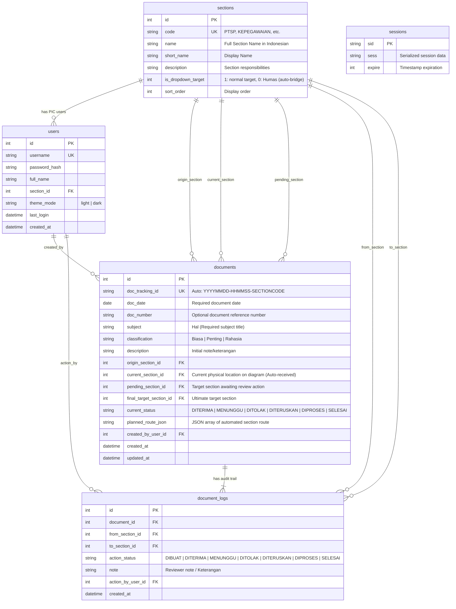

# Database Model - DOKUTRA
**Database Engine:** Local SQLite3 (`data/dokutra.sqlite`)  
*Note: In accordance with project instructions, database entities, table names, field choices, and categorical values preserve Indonesian naming matching the official office terminology, while documentation and backend code use English.*

---

## 1. Entity-Relationship Diagram (ERD)



---

## 2. Table Definitions (DDL)

### 2.1. `sections` (Master Data: 11 Sections of Kemenag Kota Metro)
Stores office sections and indicates whether each section appears as an option in the "Teruskan Dokumen Ke" dropdown.

```sql
CREATE TABLE IF NOT EXISTS sections (
    id INTEGER PRIMARY KEY AUTOINCREMENT,
    code TEXT NOT NULL UNIQUE,
    name TEXT NOT NULL,
    short_name TEXT NOT NULL,
    description TEXT,
    is_dropdown_target INTEGER NOT NULL DEFAULT 1, -- 1 = Available in dropdown; 0 = Humas Protokol (auto-bridge)
    sort_order INTEGER NOT NULL DEFAULT 0
);
```

**Seed Data Values:**
| `id` | `code` | `name` | `short_name` | `is_dropdown_target` | Description |
| :--- | :--- | :--- | :--- | :--- | :--- |
| 1 | `PTSP` | PTSP (Pelayanan Terpadu Satu Pintu) | PTSP | `1` | One-Stop Service (Incoming letters) |
| 2 | `KEPEGAWAIAN` | Kepegawaian | Kepegawaian | `1` | Staffing & Outgoing Letters |
| 3 | `PENMAD` | PENMAD (Pendidikan Madrasah) | PENMAD | `1` | Madrasah Education |
| 4 | `BIMAS_ISLAM` | BIMAS ISLAM (Bimbingan Masyarakat Islam) | BIMAS ISLAM | `1` | Islamic Guidance & KUA |
| 5 | `PAPKI` | PAPKI (Pendidikan Agama dan Keagamaan Islam) | PAPKI | `1` | Islamic Boarding Schools & Non-Madrasah PAI |
| 6 | `KATOLIK` | Penyelenggara Katolik | Katolik | `1` | Catholic and Non-Muslim Affairs |
| 7 | `ZAKAT_WAKAF` | Penyelenggara Zakat Wakaf | Zakat Wakaf | `1` | Zakat, Wakaf, Infaq & Sedekah |
| 8 | `KEUANGAN` | Perencana Keuangan | Keuangan | `1` | Finance & Treasury |
| 9 | `KASUBBAG` | Kasubbag Tata Usaha | KASUBBAG TU | `1` | Head of Administration |
| 10 | `KEPALA` | Kepala Kantor | KEPALA KANTOR | `1` | Head of Office |
| 11 | `HUMAS` | Humas Protokol | Humas Protokol | `0` | **Excluded from manual dropdown; auto-bridge** |

---

### 2.2. `users` (Section PIC Credentials & Preferences)
Stores section login credentials, assigned section, and user theme preferences.

```sql
CREATE TABLE IF NOT EXISTS users (
    id INTEGER PRIMARY KEY AUTOINCREMENT,
    username TEXT NOT NULL UNIQUE,
    password_hash TEXT NOT NULL,
    full_name TEXT NOT NULL,
    section_id INTEGER NOT NULL,
    theme_mode TEXT NOT NULL DEFAULT 'light' CHECK(theme_mode IN ('light', 'dark')),
    last_login DATETIME,
    created_at DATETIME DEFAULT CURRENT_TIMESTAMP,
    FOREIGN KEY (section_id) REFERENCES sections(id)
);
```

---

### 2.3. `documents` (Primary Tracking Records)
Tracks physical document metadata, diagram location (`current_section_id`), pending destination awaiting review (`pending_section_id`), and auto-routing queue (`planned_route_json`).

```sql
CREATE TABLE IF NOT EXISTS documents (
    id INTEGER PRIMARY KEY AUTOINCREMENT,
    doc_tracking_id TEXT NOT NULL UNIQUE, -- Auto: YYYYMMDD-HHMMSS-SECTIONCODE
    doc_date TEXT NOT NULL,               -- Format: YYYY-MM-DD
    doc_number TEXT DEFAULT '',           -- Optional reference number
    subject TEXT NOT NULL,                -- Hal (Subject title)
    classification TEXT NOT NULL CHECK(classification IN ('Biasa', 'Penting', 'Rahasia')),
    description TEXT DEFAULT '',          -- Additional note
    origin_section_id INTEGER NOT NULL,   -- Originating section
    current_section_id INTEGER NOT NULL,  -- Current physical location on diagram (auto-received on forward)
    pending_section_id INTEGER,           -- Target section awaiting review in Inbox
    final_target_section_id INTEGER,      -- Ultimate intended destination
    current_status TEXT NOT NULL CHECK(current_status IN ('DITERUSKAN', 'DITERIMA', 'DIPROSES', 'MENUNGGU', 'DITOLAK')),
    planned_route_json TEXT DEFAULT '[]', -- JSON array of pending auto-route hops, e.g. ["KASUBBAG", "KEPALA"]
    created_by_user_id INTEGER NOT NULL,
    created_at DATETIME DEFAULT CURRENT_TIMESTAMP,
    updated_at DATETIME DEFAULT CURRENT_TIMESTAMP,
    FOREIGN KEY (origin_section_id) REFERENCES sections(id),
    FOREIGN KEY (current_section_id) REFERENCES sections(id),
    FOREIGN KEY (pending_section_id) REFERENCES sections(id),
    FOREIGN KEY (final_target_section_id) REFERENCES sections(id),
    FOREIGN KEY (created_by_user_id) REFERENCES users(id)
);
```

---

### 2.4. `document_logs` (Audit Trail & Path Trajectory)
Maintains historical records of every document status change, movement, review note, and user timestamp.

```sql
CREATE TABLE IF NOT EXISTS document_logs (
    id INTEGER PRIMARY KEY AUTOINCREMENT,
    document_id INTEGER NOT NULL,
    from_section_id INTEGER NOT NULL,
    to_section_id INTEGER NOT NULL,
    action_status TEXT NOT NULL CHECK(action_status IN ('DIBUAT', 'DITERIMA', 'DIPROSES', 'DITERUSKAN', 'MENUNGGU', 'DITOLAK')),
    note TEXT DEFAULT '',
    action_by_user_id INTEGER NOT NULL,
    created_at DATETIME DEFAULT CURRENT_TIMESTAMP,
    FOREIGN KEY (document_id) REFERENCES documents(id) ON DELETE CASCADE,
    FOREIGN KEY (from_section_id) REFERENCES sections(id),
    FOREIGN KEY (to_section_id) REFERENCES sections(id),
    FOREIGN KEY (action_by_user_id) REFERENCES users(id)
);
```

---

### 2.5. `sessions` (6-Hour Persistent Cookie Store)
Persistent session store to prevent user logouts on server restarts.

```sql
CREATE TABLE IF NOT EXISTS sessions (
    sid TEXT PRIMARY KEY,
    sess TEXT NOT NULL,
    expire INTEGER NOT NULL
);
```

---

## 3. Location State Transition Matrix (Auto-Receive & Review Actions)

| Event | `current_section_id` (Diagram Location) | `pending_section_id` (Inbox Alert) | `current_status` | UI Visual Effect |
| :--- | :--- | :--- | :--- | :--- |
| **New Document Created by Section A $\rightarrow$ Section B** | **`Section B`** *(Auto-Received!)* | `Section B` | `DITERIMA` | Automatically logs `DIBUAT`, `DITERUSKAN`, and `DITERIMA`. Section B receives Big Notification Banner to review. |
| **Section B clicks Review $\rightarrow$ selects `Menunggu`** | **`Section B`** | `NULL` | `MENUNGGU` | Document stays at Section B with `MENUNGGU` badge; incoming alert cleared. |
| **Section B clicks Review $\rightarrow$ selects `Ditolak`** | **`Section B`** | `NULL` | `DITOLAK` | Document stays at Section B with `DITOLAK` badge; incoming alert cleared. |
| **Section B clicks Review $\rightarrow$ selects `Teruskan` to `KEPALA`** | **`HUMAS`** *(Auto-Received!)* | `HUMAS` *(Auto-bridge)* | `DITERIMA` | `planned_route_json` contains `["KASUBBAG", "KEPALA"]`. Document is auto-received at Humas and triggers Humas's Big Notification Banner. |
