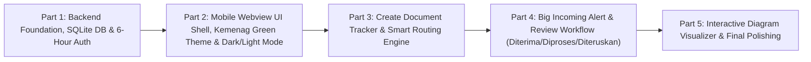

# Development Partitions & Roadmap - DOKUTRA
**Phased Implementation Plan for Kantor Kementerian Agama Kota Metro Document Tracking**

This document partitions the development of the **DOKUTRA** application into **5 sequential phases**. Each partition includes defined tasks and evaluation criteria to ensure step-by-step verification before progressing to subsequent phases.

---

## Part 1: Backend Foundation, Local SQLite Database & Multi-User 6-Hour Auth
### Scope of Work:
1. Initialize Node.js application (`package.json`), install core dependencies (`express`, `better-sqlite3`, `express-session`, `bcryptjs`, `cookie-parser`).
2. Implement database initialization script (`src/config/database.js`) establishing SQLite tables (`sections`, `users`, `documents`, `document_logs`, `sessions`) in WAL mode.
3. Seed master data for the **11 Sections** of Kantor Kemenag Kota Metro and create default PIC accounts for each section.
4. Implement authentication REST endpoints (`/api/auth/login`, `/api/auth/logout`, `/api/auth/me`) using **6-hour persistent HTTP-only cookie sessions** (`maxAge: 21600000` ms).
5. Build clean, mobile-optimized Indonesian login view with username & password credential saving support.

### Monitoring & Evaluation Checklist:
- [ ] Application starts without errors and auto-creates `data/dokutra.sqlite`.
- [ ] All 11 sections are seeded with corresponding user accounts.
- [ ] User can log in, credentials can be saved on the device, and the session persists for 6 hours across browser restarts.

---

## Part 2: Mobile Webview UI Shell, Kemenag Green Theme & User Theme Configuration
### Scope of Work:
1. Construct the responsive application shell optimized for **Phone Webviews** (sticky header with section indicator, bottom navigation bar with touch-friendly targets $\ge 44$px).
2. Establish CSS design system with **Kemenag Green** (`#006837` / `#007A3D`) as the primary brand color, with accent badges.
3. Build **Light Mode** and **Dark Mode** stylesheets with smooth transitions.
4. Implement theme toggle functionality connected to `/api/auth/theme` so the chosen theme is permanently stored in the user's database profile (`users.theme_mode`).
5. Create section listing API endpoint (`/api/sections`) with built-in separation between all sections (11) and target dropdown sections (10, excluding Humas).

### Monitoring & Evaluation Checklist:
- [ ] UI renders comfortably in mobile viewport dimensions (360px - 430px) without horizontal scrolling.
- [ ] Kemenag Green color scheme displays cleanly in both Light and Dark modes.
- [ ] Toggling theme updates the UI instantly and persists after logout and re-login.

---

## Part 3: Create New Tracker Form & Smart Routing Engine
### Scope of Work:
1. Implement the "Buat Pelacakan Dokumen Baru" (Create Tracker) form with field validations:
   - **Tanggal Dokumen:** Required, pre-filled with current date.
   - **Nomor Dokumen:** Optional text string.
   - **Hal:** Required subject title.
   - **Sifat:** Required select dropdown (`Biasa`, `Penting`, `Rahasia`).
   - **Keterangan:** Optional description.
   - **ID Dokumen:** Read-only auto-generated unique ID (`YYYYMMDD-HHMMSS-SECTIONCODE`).
   - **Teruskan Dokumen Ke:** Target dropdown with 10 sections (excluding Humas).
2. Implement backend **Smart Routing Engine**:
   - If target is **Kasubbag TU**, the system automatically routes to **Humas Protokol** first (`[Origin] -> HUMAS -> KASUBBAG`).
   - If target is **Kepala Kantor**, the system automatically routes through **Humas Protokol** and requires **Kasubbag TU** review first (`[Origin] -> HUMAS -> KASUBBAG -> KEPALA`).
   - Dynamic route preview displayed below the dropdown to inform users of the automated transit hops.

### Monitoring & Evaluation Checklist:
- [ ] Document ID auto-generates correctly and is non-editable.
- [ ] Humas Protokol is hidden from manual selection but auto-routed when Kasubbag or Kepala is chosen.
- [ ] New documents and initial logs (`DIBUAT`) are recorded accurately in SQLite.

---

## Part 4: Big Incoming Document Alert & Review Workflow
### Scope of Work:
1. Implement the **Big Notification Banner** at the top of the Home Dashboard whenever incoming documents are waiting for the logged-in section (`status = 'DITERUSKAN'` and `pending_section_id = current_user_section`).
2. Build the **Review Dokumen Masuk** modal/screen:
   - Displays full document details, classification badge, origin, and transit history.
   - Input field for **Keterangan / Catatan Tindak Lanjut**.
   - Action buttons for status change: **`Diterima`**, **`Diproses`**, and **`Diteruskan`**.
3. Implement physical location update logic:
   - Choosing `Diterima` or `Diproses` officially moves `current_section_id` to the receiving section and clears `pending_section_id`.
   - Choosing `Diteruskan` opens the forward dropdown or automatically advances to the next hop if part of a pre-planned route.

### Monitoring & Evaluation Checklist:
- [ ] Prominent alert banner appears immediately when a document arrives for the current user's section.
- [ ] Selecting `Diterima` or `Diproses` shifts the document location to the receiving section.
- [ ] The chain `Section -> Humas Protokol -> Kasubbag TU -> Kepala Kantor` advances seamlessly between respective PIC logins.

---

## Part 5: Interactive Diagram Visualizer (Focused & All-Section Modes) & Polishing
### Scope of Work:
1. Build the **Focused Diagram Visualizer** (default view) on the Dashboard:
   - Renders only the sections participating in the selected document's trajectory.
   - Highlights the current physical location node with status indicator (`Diterima` / `Diproses` / `Diteruskan`).
   - Suppresses uninvolved sections to keep mobile displays clean.
2. Build the **All Sections Mode** (Read-Only toggle):
   - Toggle button on the dashboard to display all 11 sections in an office-wide grid.
   - Shows all active documents stationed at each section for complete tracking transparency.
3. Comprehensive end-to-end testing, error handling, and performance optimization for webviews.

### Monitoring & Evaluation Checklist:
- [ ] Focused diagram only displays relevant sections along the document's path.
- [ ] Toggle button switches smoothly between Focused View and All Sections View.
- [ ] Complete document lifecycle can be traced and audited end-to-end across multiple section accounts.
